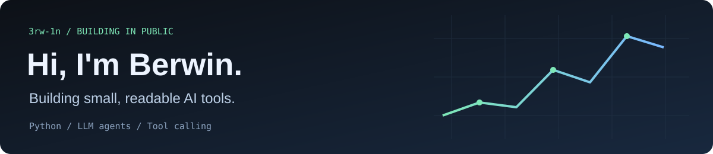
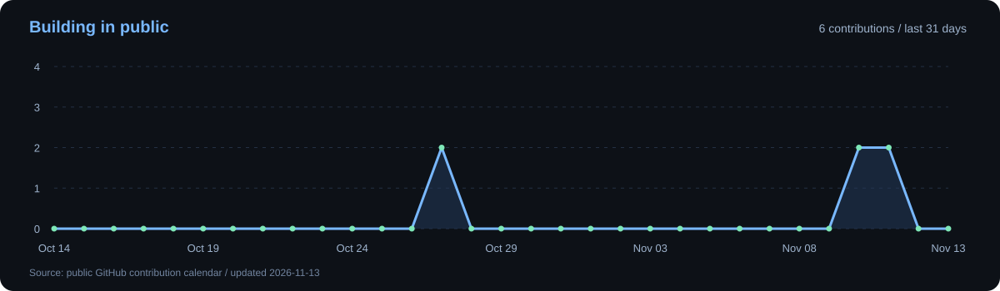

**Python · LLM agents · Tool calling**

Learning in public, one project at a time.

[Explore nano-agent](https://github.com/3rw-1n/nano-agent) · [My repositories](https://github.com/3rw-1n?tab=repositories)

### About me

I'm Berwin. I build small Python projects to understand how AI tools work, then share the code and what I learn.

- **Building:** [nano-agent](https://github.com/3rw-1n/nano-agent), a tiny DeepSeek agent with a visible tool-calling loop.
- **Exploring:** function calling, conversation memory, and useful Python tools.
- **Open to:** Python / AI development opportunities and open-source collaboration.

### Tools & interests

  
  
  
  
  
  

### GitHub at a glance

  
  

### Contribution activity

### Featured project — nano-agent

**Understand the agent by reading the code.**

A tiny DeepSeek agent that turns typed Python functions into tools. Follow the model requests, tool results, and final answer in four core files.

- Stock lookup and Python arithmetic tools.
- An offline replay you can try without an API key.
- English and Simplified Chinese documentation.

The clip uses scripted model responses and a fixed quote; the agent loop and calculator execute locally.

**[Read the code →](https://github.com/3rw-1n/nano-agent)**

---

Have a useful tool idea or feedback? [Open a discussion through an issue](https://github.com/3rw-1n/nano-agent/issues).
